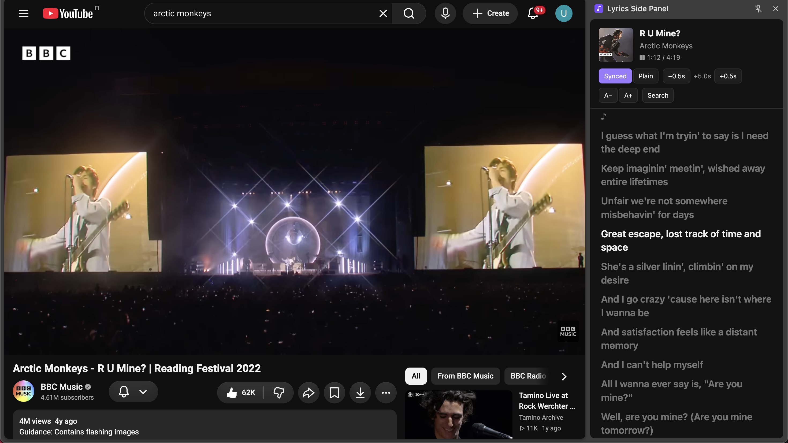

# Lyrics Side Panel Chrome Extension

A Chrome extension that detects the song playing in your browser and shows its lyrics in Chrome's **Side Panel**, so you can keep browsing other tabs while the lyrics stay next to you. If time-synced lyrics are available, they scroll along with the song and the current line is highlighted.

- Works with **Spotify Web Player**, **YouTube Music**, **YouTube** and **SoundCloud**
- Synced (karaoke-style) lyrics when available, plain lyrics otherwise
- Time offset buttons (−0.5 s / +0.5 s) to fix drift
- Font size buttons (A− / A+)
- Manual search if a track isn't found automatically
- Backup lyrics source ([lyrics.ovh](https://lyrics.ovh), plain lyrics only) for when LRCLIB is down
- Lyrics are cached locally in your browser
- No account, no API key, no tracking, no build step

Lyrics come from [LRCLIB](https://lrclib.net), a free community lyrics database (**source 1**). If LRCLIB is unreachable, you can switch to [lyrics.ovh](https://lyrics.ovh), a free open-source lyrics API (**source 2**). Both are free and need no account or API key.

<p align="center">
  
</p>

## Requirements

Google Chrome **114 or newer** (check at `chrome://settings/help`). Other Chromium browsers with Side Panel support may work but are untested.

## Installation

This extension is not on the Chrome Web Store, so you load it manually (takes about a minute).

1. Download this repository: click the green **Code** button on GitHub, then **Download ZIP**, and unzip it. (Or run `git clone https://github.com/robuno/lyrics-side-card-extension`.)
2. In Chrome, type `chrome://extensions` in the address bar.
3. Turn on the **Developer mode** toggle in the top right.
4. Click **Load unpacked**.
5. Select the project folder (the one that contains `manifest.json`).
6. Click the puzzle icon at the top right of Chrome and **pin** the extension to the toolbar.

## Usage

1. Open [open.spotify.com](https://open.spotify.com), [music.youtube.com](https://music.youtube.com), YouTube or SoundCloud and play a song.
2. Switch to any other tab if you like.
3. Click the extension icon, or press **Alt+L**. The side panel opens and the lyrics appear.
4. To change the shortcut, go to `chrome://extensions/shortcuts`.

In the panel you can:

- Shift the lyrics timing with the **−0.5 s / +0.5 s** buttons if they run early or late
- Change the text size with **A− / A+**
- Search manually if the track isn't recognized
- Switch lyrics source if LRCLIB is down (see below)

### If LRCLIB is down

LRCLIB is a free community service and is sometimes unavailable. When that happens the panel shows "Couldn't reach the lyrics server." Press **Retry**. If it still fails, the panel asks whether to search **source 2 (lyrics.ovh)** instead.

- While source 2 is active, a **"Lyrics source 2"** label appears in the top menu (hover it to see it is lyrics.ovh).
- Source 2 has **plain lyrics only**: the Synced/Plain toggle and the time offset buttons are disabled. Font size still works.
- Manual search on source 2 needs the exact title and artist.
- The choice is remembered. Click **Use source 1** in the top menu to switch back to LRCLIB and try again. The extension does not switch back by itself.

## Privacy

- The extension has no server and collects no personal data.
- The track title and artist of the song you're playing are sent to `lrclib.net` solely to look up lyrics. If you switch to source 2, they are sent to `api.lyrics.ovh` instead.
- Found lyrics are cached in your own browser (`chrome.storage.local`). Your settings (time offset, font size) are saved with `chrome.storage.sync`, which Chrome may sync across your signed-in devices.

## Permissions

| Permission | Why it's needed |
|---|---|
| `sidePanel` | Show the lyrics in Chrome's side panel |
| `tabs` | Find which tab is currently playing audio |
| `storage` | Cache lyrics and save your settings |
| `https://lrclib.net/*` | Fetch lyrics from LRCLIB (source 1) |
| `https://api.lyrics.ovh/*` | Fetch lyrics from lyrics.ovh (source 2, backup) |
| Content scripts on Spotify, YouTube Music, YouTube, SoundCloud | Read the currently playing track and playback position |

## Troubleshooting

- **Panel doesn't open:** Make sure Chrome is version 114 or newer.
- **Track isn't detected:** Refresh the music tab (F5). A song must actually be playing in that tab.
- **Lyrics scroll at the wrong time:** Adjust with the time offset buttons in the panel.
- **Lyrics not found:** Use the manual search box. The track may not be in LRCLIB yet. You can [contribute lyrics to LRCLIB](https://lrclib.net) yourself.
- **"Couldn't reach the lyrics server":** LRCLIB may be down. Press **Retry**, then use source 2 if the panel offers it.
- **Live or acoustic versions scroll out of sync:** LRCLIB usually has timings for the studio recording only. Try the offset buttons, or switch to **Plain** lyrics.
- **Debugging:**
  - Right-click the panel → **Inspect** → Console
  - `chrome://extensions` → click the **service worker** link on the extension's card → Console
  - In the music tab, press F12 → Console (content script logs)

## Known limitations

- The **Spotify desktop app is not supported**, only the Spotify Web Player in Chrome.
- Not every track has lyrics; coverage depends on the LRCLIB community database.
- Source 2 (lyrics.ovh) has no timestamps and can be slow or less accurate.
- If Spotify or YouTube change their page layout, the selectors in `content/selectors.js` may need updating.

## Development

No build step and no dependencies. The code is plain JavaScript (ES modules, Manifest V3).

```
manifest.json
background/service-worker.js   # message routing, lyrics requests, cache, active tab selection, source switching
content/detector.js            # reads mediaSession + playback position, reports to background
content/selectors.js           # per-site DOM selectors (one place, easy to update)
lib/clean-title.js             # title/artist cleanup
lib/lrc-parser.js              # parses the LRC format
lib/lrclib.js                  # LRCLIB API client (source 1)
lib/lyricsovh.js               # lyrics.ovh API client (source 2, backup)
sidepanel/                     # the side panel UI (HTML, CSS, JS)
tests/                         # Node tests
```

Run the tests (Node 18+):

```
node --test
```

(`node --test tests/` fails on newer Node versions, which treat `tests/` as a file name.)

After changing code, click the **reload (↻)** button on the extension's card in `chrome://extensions`, and refresh the open music tab (F5), because content scripts load when the page opens.

## Disclaimer

This project is not affiliated with or endorsed by Spotify, YouTube, Google, SoundCloud or LRCLIB. All product names and trademarks belong to their respective owners. Lyrics are the property of their respective rights holders and are fetched on demand from LRCLIB and lyrics.ovh; this project does not host or redistribute them.

## License

MIT, see [LICENSE](LICENSE).
